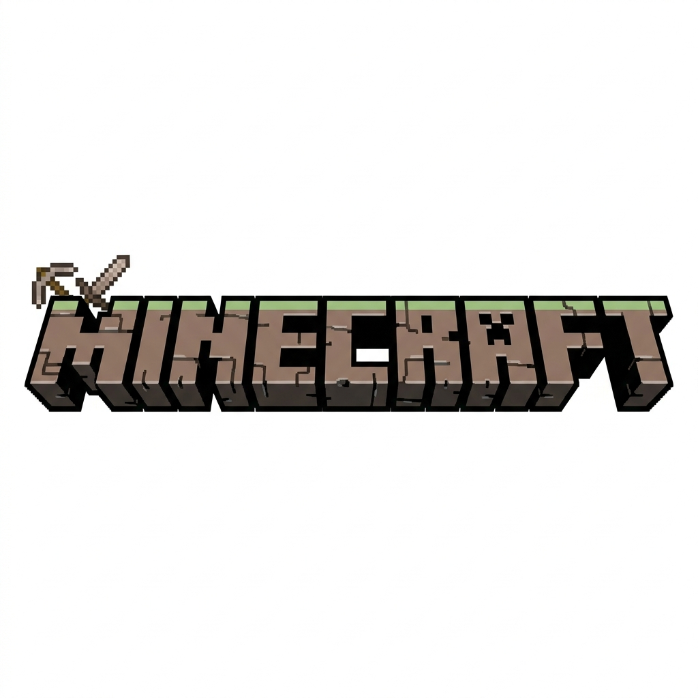

<div align="center">



# MINECRAFTWIKI


**Wiki de escritorio de Minecraft** — catálogo de mobs e ítems con ficha
detallada en español, estética pixel-art y arquitectura MVVM.

</div>

## Qué hace

App de escritorio **WPF sobre .NET 10** que lista entidades de Minecraft —
mobs hostiles, neutrales y pasivos, además de ítems — en una vista
maestro-detalle: eliges un elemento en la lista y ves su ficha con imagen,
categoría, tipo, vida y descripción.

## Características

- 📖 **Catálogo en español** de mobs e ítems: nombre, categoría, tipo, vida y descripción.
- 🖼️ **Imágenes de los assets oficiales** con diccionario de corrección automática — cuando una URL responde 404 se usa `mc-heads.net`.
- 💾 **Doble fuente de datos**: JSON remoto + respaldo local `API/MOBS.json` — la app no se queda vacía si el remoto cae.
- 🎨 **Estética Minecraft**: fuente PressStart2P, fondo y logo incluidos en `Assets/`.
- 🏗️ **MVVM**: `CommunityToolkit.Mvvm` + `INotifyPropertyChanged`, vista desacoplada del estado.

## Estructura

```
MINECRAFTWIKI/
├─ API/MOBS.json                Catálogo local (respaldo)
├─ MODELS/MinecraftEntity.cs    Modelo: id, nombre, categoría, tipo, vida, imagen, descripción
├─ SERVICES/ApiService.cs       Carga remota + fallback local + fixes de imágenes
├─ VIEWMODEL/MainViewModel.cs   Estado: ObservableCollection + entidad seleccionada
├─ VIEW/MainWindow.xaml         Vista maestro-detalle
└─ Assets/                      PressStart2P · background.png · logo.png
```

## Ejecutar

Requisitos: **Windows** + **.NET 10 SDK**.

```bash
dotnet run --project MINECRAFTWIKI/MINECRAFTWIKI.csproj
```

O abrir `MINECRAFTWIKI.slnx` en Visual Studio y pulsar **F5**.
